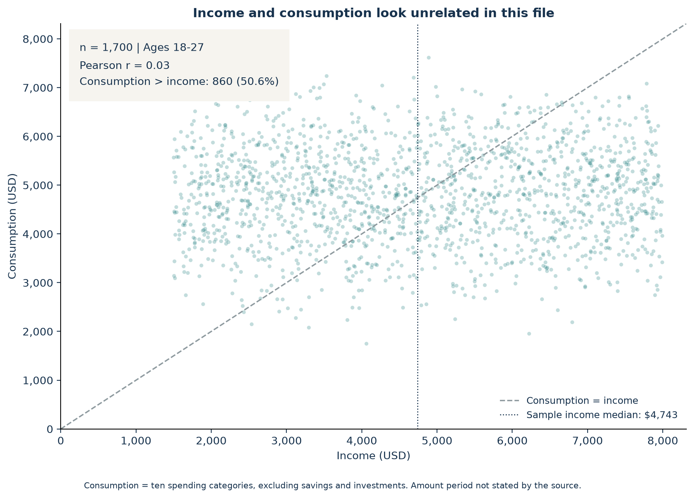
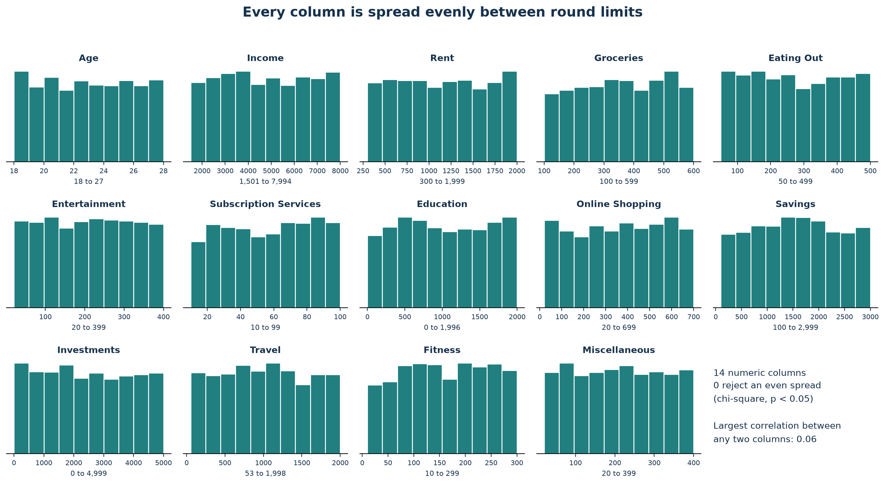
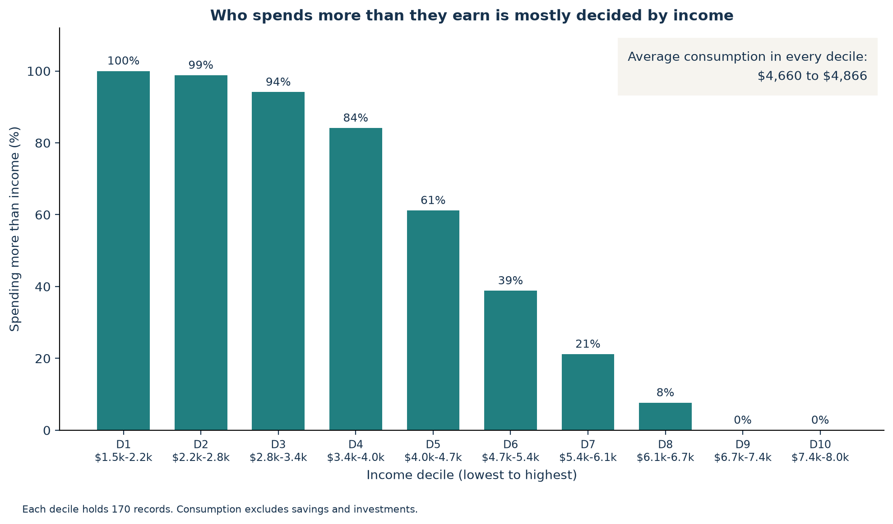
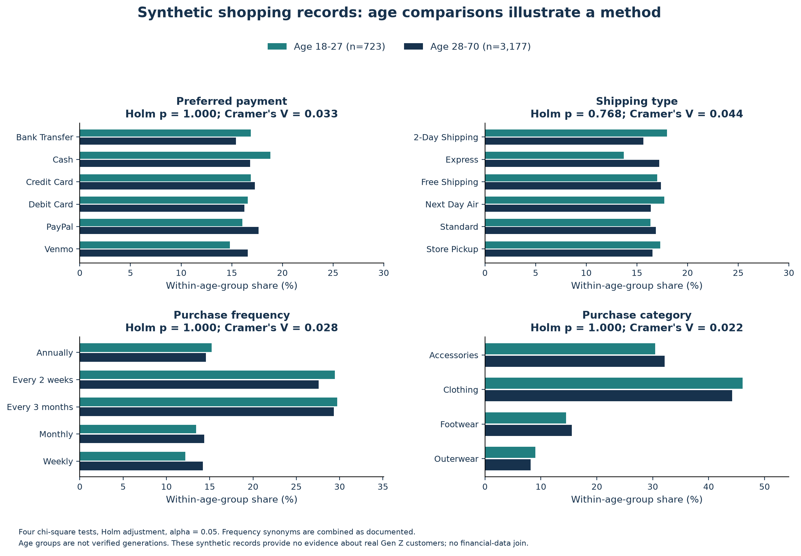

# Gen Z Spending: Re-checking a Course Project

I rebuilt the financial analysis from a UW IS 445 group project in SQLite, checked every number independently in Python, and took a closer look at the data behind it.

## Summary

- **The course's two headline numbers reproduce exactly.** Income and consumption have a correlation of 0.03, and 860 of 1,700 records (50.6%) spend more than their income.
- **The financial data looks randomly generated.** All 14 numeric columns are spread evenly between round limits, and no two columns correlate above 0.06. The low correlation comes from how the file was built, not from how Gen Z spends.
- **Spending above income is mostly an income effect.** Average consumption is about $4,800 in every income decile, so 88% of below-median earners spend more than they earn, versus 14% of everyone else.
- **Age groups shop the same way in the shopping data.** None of the 4 age comparisons (payment, shipping, frequency, category) is significant after Holm correction. That dataset is synthetic.
- **What I would do with real data:** segment customers on what they actually buy, A/B test one change at a time on small groups, and check a dataset's source and distribution before building recommendations on it.

One-page summaries: [English PDF](outputs/summary_en.pdf) | [中文 PDF](outputs/summary_zh.pdf)

## Course project and individual extension

- **Course group project:** UW IS 445 (SQL), March-June 2025. The group studied Gen Z financial and shopping patterns and presented marketing recommendations. My role was data analysis and visualization with SQL, Excel and Python.
- **Individual extension (October 2026):** the original files and code were lost, so I rebuilt the analysis on my own: source checks, SQLite tables and queries, independent Python verification, the distribution check, the income breakdown, the age comparisons, figures and the bilingual summaries.

The original presentation, my teammates' names and their code are not included.

## Data

| Dataset | Version | Size | Notes |
| --- | --- | ---: | --- |
| [Gen Z Money Spending](https://www.kaggle.com/datasets/manandkumar/gen-z-money-spending-dataset) | 1, released 2025-01-31 | 1,700 x 15 | CC0, included in `data/raw/`. Collection method not documented; looks randomly generated (see result 2). |
| [Customer Shopping Trends](https://www.kaggle.com/datasets/iamsouravbanerjee/customer-shopping-trends-dataset) | 2 | 3,900 x 18 | Synthetic, per the publisher. Not redistributed; `src/00_download_shopping.py` fetches the pinned version. |

The two datasets describe different records and are never joined. The financial file's field names, age range, record count and both headline numbers match the course presentation, so it is very likely the same data. The original course file was lost, so an exact match can't be confirmed. Details are in [data/README](data/README.md) and the [data dictionary](data/data_dictionary.md).

## Results

### 1. The headline numbers reproduce

| Measure | Recalculated | Course presentation |
| --- | ---: | ---: |
| Income vs consumption, Pearson r | 0.0301 | 0.03 |
| Consumption above income | 860 / 1,700 = 50.6% | 50.6% |

Consumption is the sum of ten spending categories: rent, groceries, eating out, entertainment, subscriptions, education, online shopping, travel, fitness and miscellaneous. Savings and investments are kept separate.



### 2. The financial data looks randomly generated

Real income data is usually skewed, with a long tail of high earners. Here every column is close to flat between round limits: income runs from $1,501 to $7,994, rent from $300 to $1,999 and groceries from $100 to $599. A chi-square test against an even spread (10 bins per column) rejects none of the 14 columns at p < 0.05, and the largest correlation between any two columns is 0.06. That pattern fits independent random draws much better than survey data. Full table: [finance_generation_check.csv](outputs/tables/finance_generation_check.csv).



So the near-zero correlation is a property of the file, not evidence about Gen Z.

### 3. Spending above income is mostly an income effect

Average consumption stays between $4,660 and $4,866 in every income decile, while income ranges from about $1,500 to $8,000. Whether someone spends more than they earn therefore depends almost entirely on their income.

| Income group | Records | Spend more than income |
| --- | ---: | ---: |
| Below the median ($4,743) | 849 | 88% |
| At or above the median | 851 | 14% |



The four rule-based groups from the first version (income half x spending above or below income) are still in [finance_segments.csv](outputs/tables/finance_segments.csv). Two of them hold 87% of records and simply follow income; the other two (6% and 7%) are mostly people near the median. Because the groups mostly restate income, I did not attach separate marketing actions to them.

### 4. Age groups shop the same way (synthetic shopping data)

Ages 18-27 (n = 723) vs 28-70 (n = 3,177), four planned chi-square tests with Holm correction:

| Outcome | Holm-adjusted p | Cramer's V |
| --- | ---: | ---: |
| Preferred payment method | 1.00 | 0.03 |
| Shipping type | 0.77 | 0.04 |
| Shopping frequency | 1.00 | 0.03 |
| Product category | 1.00 | 0.02 |

None is significant and the effect sizes are tiny, so this data does not support age-specific payment or delivery campaigns.



### 5. Re-check notes

While rebuilding, I also recalculated the other figures from the course presentation:

- The 13.48% (self-investment) and 14.19% (enjoyment) shares reproduce when the denominator is consumption plus savings and investments. With consumption alone, they are 23.81% and 25.21%.
- Enjoyment as a share of income reproduces at 31.06%. Self-investment as a share of income recalculates to 29.82% (presentation: 29.98%).
- With the presentation's age definition for the shopping data (802 records aged 18-28), the mean review rating reproduces at 3.79. Shipping shares recalculate to 18.2% (2-Day Shipping) and 18.5% (Next Day Air), versus 17.5% shown.

Self-investment = education + fitness; enjoyment = travel + entertainment. Details: [denominator audit](outputs/tables/finance_denominator_audit.csv) and [shopping definition check](outputs/tables/shopping_report_definition_preferences.csv).

## Recommendations

What I would do in a real version of this analysis ([marketing_actions.csv](outputs/tables/marketing_actions.csv)):

1. **Segment real customers on what they actually buy** (category mix, repeat purchases, response to past promotions), not on income or age alone. In this file, income tells you almost nothing about spending.
2. **Start with one shared offer, then A/B test one change at a time** (price, delivery fee, promotion timing) on small groups before rolling it out. The age groups here showed no meaningful differences.
3. **Check where a dataset comes from and how it is distributed** before building recommendations on it. A quick look at the distributions changed how this project's results should be read.

## Methods

1. **Source checks:** SHA-256 fingerprint, headers, record counts, missing values and duplicate IDs. All 1,700 financial and 3,900 shopping records are kept.
2. **SQLite:** the files in `sql/` compute every exported financial number (correlation, counts, medians, income deciles, group summaries). `src/01_finance.py` recomputes each table with pandas and stops if anything differs.
3. **Distribution check:** a 10-bin chi-square test against an even spread for each numeric column, plus all pairwise correlations.
4. **Shopping comparison:** fixed age groups 18-27 and 28-70, frequency synonyms merged, four planned chi-square tests, Holm correction and Cramer's V. All expected cell counts are above 5.
5. **Verification:** `src/05_verify.py` re-checks the published tables and key README numbers. CI runs it on every push.

## Limitations

- The financial publisher does not say how the data was collected or what period the amounts cover, so income and spending are compared as recorded.
- The shopping data is synthetic. Neither dataset supports claims about real Gen Z consumers.
- The two datasets are separate, so financial and shopping patterns can't be linked for the same person.

## How to run

Use Python 3.12 or later with the pinned dependencies.

```bash
# Create a local environment and install the analysis dependencies.
python3 -m venv .venv
source .venv/bin/activate
python -m pip install -r requirements.txt

# Rebuild the financial results from the included CSV.
python src/01_finance.py

# Download the pinned synthetic shopping data, then recompute its tests.
python src/00_download_shopping.py
python src/02_shopping.py

# Recreate the recommendations, figures and the two one-page summaries.
python src/03_recommendations.py
python src/03_plot.py
python src/04_summaries.py

# Re-check the published tables and the main README numbers.
python src/05_verify.py
```

Run the commands from the repository root. The finance steps work offline. The shopping step needs the raw CSV; the committed aggregate tables are enough to re-check the saved tests. CI rebuilds the finance results and runs the verification script. For the Chinese PDF, `src/04_summaries.py` embeds the font set in `GENZ_CJK_FONT` (and optionally `GENZ_CJK_BOLD_FONT`), falls back to Arial Unicode on macOS, and otherwise uses a built-in CID font.

## Repository structure

```text
data/           Source notes, data dictionary and the financial CSV
sql/            Financial views, core metrics, rule groups and income deciles
src/            Scripts for download, analysis, figures, summaries and checks
outputs/        Figures, aggregate result tables and bilingual summaries
.github/        Reproducibility checks
```

## Method references

- [SciPy Pearson r](https://docs.scipy.org/doc/scipy/reference/generated/scipy.stats.pearsonr.html)
- [SciPy chi-square test](https://docs.scipy.org/doc/scipy/reference/generated/scipy.stats.chisquare.html)
- [SciPy chi-square contingency test](https://docs.scipy.org/doc/scipy/reference/generated/scipy.stats.chi2_contingency.html)
- [CC0 terms for the financial source](https://creativecommons.org/publicdomain/zero/1.0/)

The financial source's CC0 designation covers that dataset only. It does not license the shopping dataset or this repository's code and writing.
