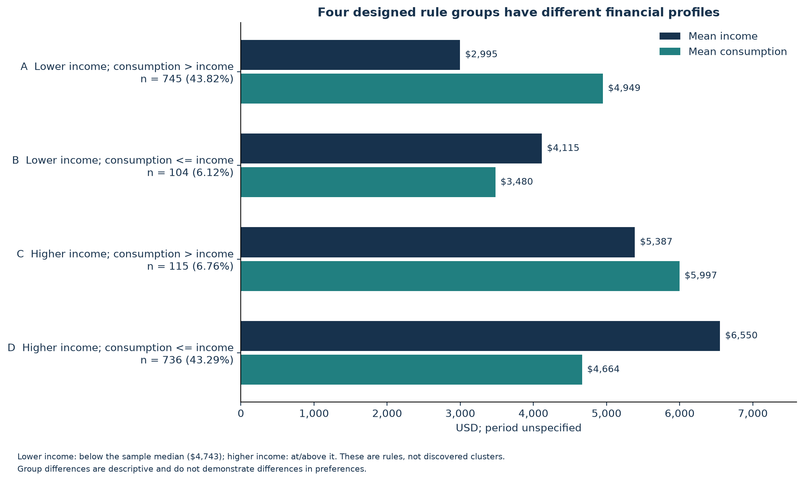

# Gen Z Spending: Reproduction and Individual Extension

A SQL-first reconstruction of a UW IS 445 course analysis, followed by a small, explainable segmentation and a separate shopping-preference comparison.

**Evidence boundary:** the financial source's observed-versus-synthetic status and amount period are undocumented. The shopping source is explicitly synthetic. These results describe the supplied records and demonstrate an analytical workflow; they are not representative estimates of real Gen Z consumers.

## Research questions

1. Can the recovered financial data reproduce the course's income-consumption correlation of 0.03 and spending-above-income rate of 50.6%?
2. What do four simple income and consumption rules reveal about spending composition?
3. In the separate shopping dataset, do payment, shipping, shopping frequency or product-category distributions differ between age 18-27 and age 28-70?
4. What specific marketing tests follow from the evidence, without assuming causal effects?

## Data sources and recovery

| Source | Reviewed version | Records / columns | Provenance and public files |
| --- | --- | --- | --- |
| [Gen Z Money Spending](https://www.kaggle.com/datasets/manandkumar/gen-z-money-spending-dataset) | 1, released 2025-01-31 | 1,700 / 15 | Observed versus synthetic unknown. Publisher marks CC0; financial CSV included. |
| [Customer Shopping Trends](https://www.kaggle.com/datasets/iamsouravbanerjee/customer-shopping-trends-dataset) | 2 | 3,900 / 18 in updated CSV | Explicitly synthetic. Raw redistribution unclear; raw CSV excluded, pinned download instructions provided. |

The presentation's 1,700 records and 15 columns refer to the financial table alone. The original course files and code were lost. Financial field names, age range, upload date and both core results match the presentation, giving strong evidence of recovery, but byte-for-byte identity with the lost course file cannot be established. The shopping source remains a recovered candidate with documented differences in age definitions. Full provenance, fingerprints, original headers and download links are in [data/README](data/README.md) and the [data dictionary](data/data_dictionary.md).

The samples describe different records. They are never joined, and a financial segment is never assigned a payment or shipping preference from the shopping sample.

## Methods

1. **Source and quality checks.** Verify pinned SHA-256 fingerprints, expected headers, record counts, missing values and duplicate identifiers. Retain all 1,700 financial and 3,900 shopping records; exclusions are zero.
2. **SQLite reproduction.** Consumption sums rent, groceries, eating out, entertainment, subscriptions, education, online shopping, travel, fitness and miscellaneous. Savings and investments are separate financial allocations. SQLite computes centered Pearson r, counts, denominators, medians and group summaries; pandas/NumPy independently verifies all financial result fields.
3. **Four designed rule groups.** Cross income below the sample median of $4,743 versus at/above it with consumption above income versus at/below it. The two dimensions produce four interpretable cells. Each contains at least 104 records, so all four are retained. Ties yield 849 below and 851 at/above the median. This is an analyst-defined partition, not evidence of four natural clusters. K-means is unnecessary for these directly explainable rules.
4. **Preference comparison.** Use separate, fixed age groups 18-27 and 28-70, rather than claiming verified generations. Normalize the source's frequency synonyms, then run four prespecified chi-square tests with Holm adjustment and Cramer's V. All expected cells exceed 5. ANOVA is unnecessary for these categorical outcomes.
5. **Interpretation.** Grouping fields are not tested against their own group labels as new discoveries. Financial category shares are exploratory and compositional. Recommendations are proposed tests, not measured campaign outcomes.

For each step, the accompanying finding and marketing meaning appear in the results and the [one-page English summary](outputs/summary_en.pdf) / [Chinese summary](outputs/summary_zh.pdf).

## Main results

### 1. Both financial headlines reproduce

| Measure | Recalculated result | Course display |
| --- | ---: | ---: |
| Income-consumption Pearson r | 0.0300818701 | 0.03 |
| Consumption above income | 860 / 1,700 = 50.5882% | 50.6% |
| Equal income and consumption | 0 records | Not reported |

Finding: the recorded income and consumption fields have a very weak linear association. Marketing meaning: these records provide little support for using income alone to predict spending; they do not establish that income has no causal effect.


### 2. Four interpretable profiles, with one test per group

All amounts below are source USD over an **unspecified period**, not verified monthly amounts. Income labels are relative to this sample. The recommendations are hypotheses based only on these financial records.

| Group | Records | Sample share | Mean income | Mean consumption | Proposed marketing test |
| --- | ---: | ---: | ---: | ---: | --- |
| A: lower income, consumption above income | 745 | 43.8% | $2,995 | $4,949 | Test a small, one-time starter bundle with its full price visible before checkout. |
| B: lower income, consumption not above income | 104 | 6.1% | $4,115 | $3,480 | Test an optional low-entry education or fitness trial without automatic renewal. |
| C: higher income, consumption above income | 115 | 6.8% | $5,387 | $5,997 | Test a fixed-total-price education and fitness bundle, without installment or credit messaging. |
| D: higher income, consumption not above income | 736 | 43.3% | $6,550 | $4,664 | Test an optional experience upgrade alongside a clearly priced standard offer. |

Evidence for B: mean individual education-and-fitness share is 20.1% of consumption. Evidence for C: education and fitness average $1,595, or 26.6% of individual consumption. Evidence for D: travel and entertainment average $1,207. A's proposal responds to the recorded consumption-income comparison rather than a claimed desire for discounts. These are exploratory profiles; neither a causal mechanism nor willingness to pay was measured. Measure take-up and cancellations in a small future test before scaling, without assuming any performance gain.



### 3. The shopping sample does not support differentiated preference claims

The separate synthetic shopping sample contains 723 records aged 18-27 and 3,177 aged 28-70.

| Prespecified outcome | Holm-adjusted p | Cramer's V |
| --- | ---: | ---: |
| Preferred payment method | 1.0000 | 0.0332 |
| Shipping type | 0.7680 | 0.0436 |
| Shopping frequency | 1.0000 | 0.0281 |
| Product category | 1.0000 | 0.0220 |

Finding: none of the four comparisons provides sufficient evidence of a distribution difference at the 0.05 threshold after correction. Marketing meaning: this synthetic example does not justify age-specific payment or delivery campaigns. It does not prove the groups have identical preferences, and it is not population evidence. Use a shared baseline offer; test delivery prices or promotion timing with real customer data before making differentiated claims.


### 4. The denominator audit changes an original interpretation

The presentation's 13.48% self-investment and 14.19% enjoyment shares reproduce when their denominator includes **consumption, savings and investments**. The remaining 72.33% therefore cannot all be called basic needs. Using consumption alone, the mean individual shares are 23.81% and 25.21%, respectively. Remaining consumption is not automatically essential spending either.

The self-investment share of income is 29.82%, not the presentation's 29.98%; this discrepancy is retained. The enjoyment share of income reproduces 31.06%. No records or formulas were changed to force a match. See the [denominator audit](outputs/tables/finance_denominator_audit.csv).

For a separate shopping replication check, the presentation's page 5 definition of ages 13-28 corresponds to 802 observable records aged 18-28 in this source. The mean rating is 3.7934, reproducing 3.79. However, 2-Day Shipping is 18.2% and Next Day Air is 18.5%, neither reproducing the displayed 17.5%. This documented course-definition diagnostic is separate from the extension's fixed 18-27 comparison; no other cutoffs were searched to force agreement. See [shopping report-definition results](outputs/tables/shopping_report_definition_preferences.csv).

## Limitations

- Financial sampling, geography, collection date, actual-versus-synthetic status and amount period are unknown. The upload date is not the collection date. Spending-income comparisons assume comparable periods.
- Shopping data are synthetic. Tests describe this educational example and cannot establish real-market demand.
- The source files cannot establish debt, affordability, financial distress, emotional motivation, loyalty, price elasticity or causal effects. The arithmetic spending-above-income label should not be interpreted as a diagnosis.
- Rule boundaries are designed, including the median cutoff. All group descriptions are exploratory; their inputs do not independently validate the groups. No optimal number of natural clusters is claimed.
- Age is not a verified generation without a collection year. Financial and shopping samples cannot provide joint individual-level segmentation.
- Preference choices do not reveal delivery prices, promotion response or campaign profitability. No ROI, sales uplift or optimal discount was estimated.
- Self-investment and enjoyment are analyst-defined combinations, and proportions depend on the denominator and weighting convention.

## Original Course Group Project and Individual Extension After the Course

**Original course group project:** UW IS 445 (SQL), March-June 2025. The group studied Gen Z financial and shopping patterns and presented marketing recommendations. My role was data analysis and visualization using SQL, Excel and Python. The course's questions and reported values are described as group work, not claimed as a wholly individual project.

**Individual extension after the course:** this repository independently reconstructs the source checks, SQLite tables and queries, financial metric reproduction, four rule-based profiles, denominator audit, separate age-group preference tests, revised recommendations, figures and bilingual summaries. The implementation was rebuilt after the course because the original files and code were no longer available. This is an extension and reimplementation, not the original group submission.

The original presentation, other participants' names and their code are not included. No claim is made that every original result or recommendation was reproduced or validated.

## How to run

Use Python 3.12 or later. The pinned dependency versions were used for the published run.

```bash
# Create a local environment and install the analysis dependencies.
python3 -m venv .venv
source .venv/bin/activate
python -m pip install -r requirements.txt

# Rebuild the included financial source and its independently verified SQL results.
python src/01_finance.py

# Download the pinned synthetic shopping source locally, then recompute its tests.
python src/00_download_shopping.py
python src/02_shopping.py

# Recreate the figures and the two one-page summaries from the result tables.
python src/03_recommendations.py
python src/03_plot.py
python src/04_summaries.py

# Independently check the public result tables and the main narrative numbers.
python src/05_verify.py
```

Run these commands from the repository root. The source scripts also resolve project paths when called from elsewhere. If Kaggle download is unavailable, use the pinned download link in [data/README](data/README.md). Do not substitute another dataset. Finance reproduction works offline using the included CSV; full shopping recomputation requires its local raw CSV. The committed shopping aggregate tables permit checking the saved chi-square tests without redistributing the raw source. The CI workflow rebuilds finance and verifies the saved aggregates; it does not claim to re-download shopping data on every run. The Chinese PDF uses an embedded system CJK font on macOS, with a standard CID-font fallback elsewhere; the fallback requires CJK support in the PDF reader. Markdown summaries contain the same information without a font dependency.

## Repository structure

```text
data/           Source notes, dictionary, financial CSV and local-only inputs
sql/            Financial views, core metrics and segment summaries
src/            Sequential scripts for download, analysis, figures and checks
outputs/        Rebuilt figures, aggregate result tables and bilingual summaries
.github/        Reproducibility checks
```

## Method references

- [SciPy Pearson r](https://docs.scipy.org/doc/scipy/reference/generated/scipy.stats.pearsonr.html)
- [SciPy chi-square contingency test](https://docs.scipy.org/doc/scipy/reference/generated/scipy.stats.chi2_contingency.html)
- [CC0 terms for the financial source](https://creativecommons.org/publicdomain/zero/1.0/)

The financial source's CC0 designation does not license the separate shopping dataset or automatically grant a blanket license to this repository's original code and writing.
